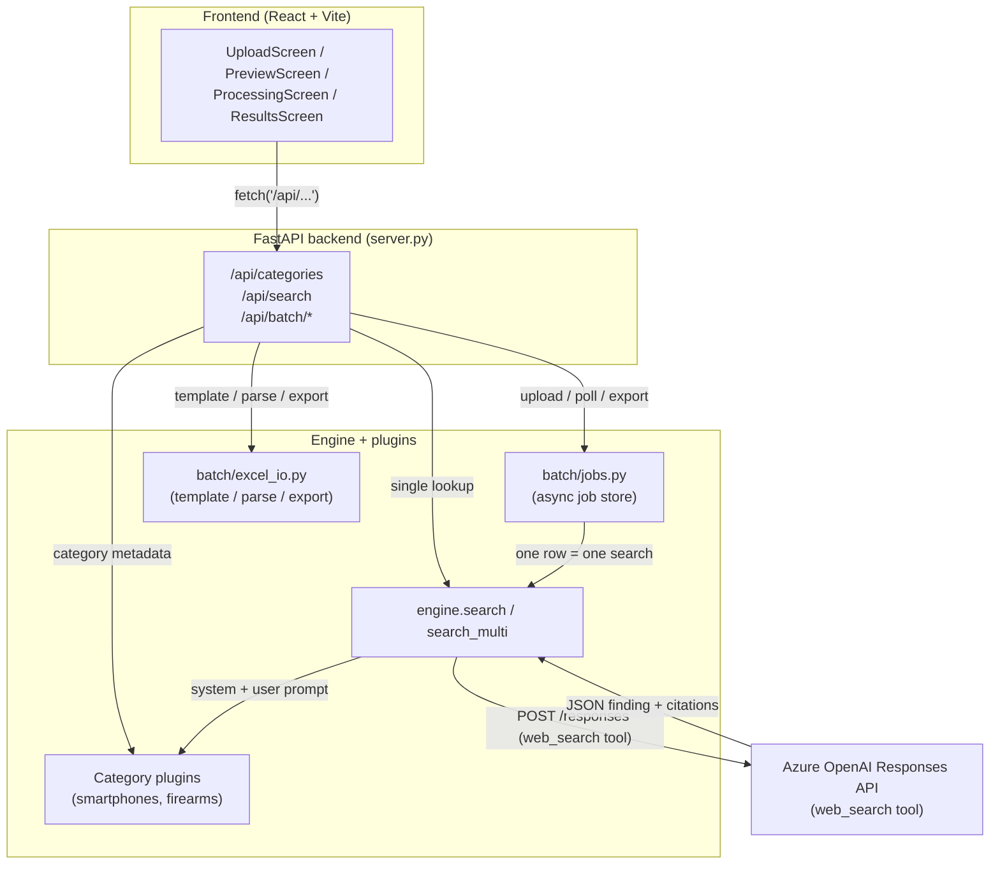
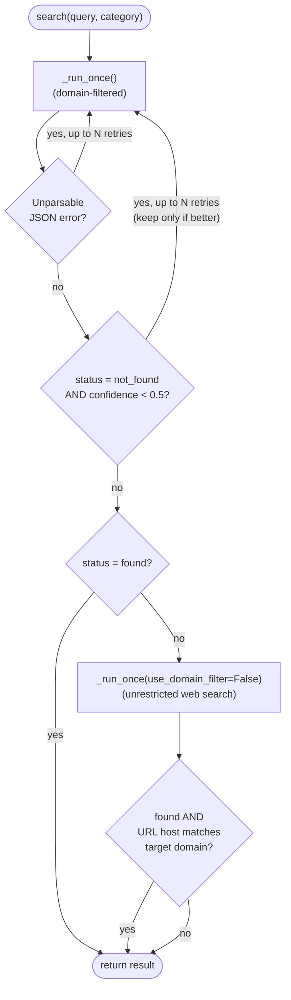
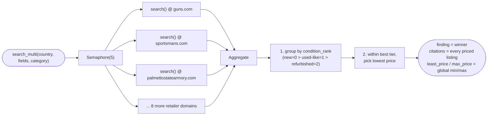
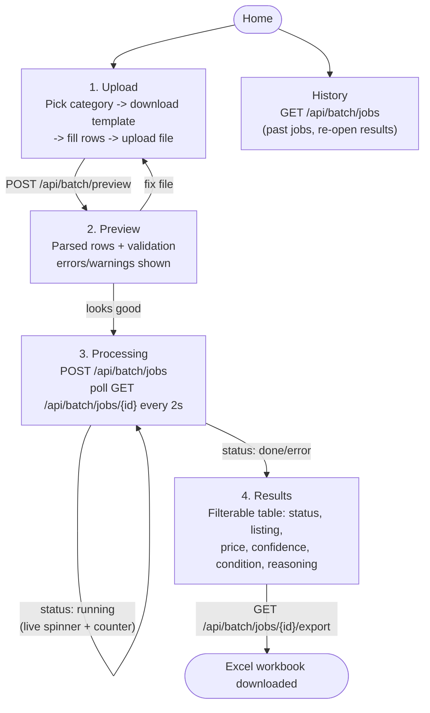

> **Websearch Price Tool** — 20/20 smartphone test cases and 30/30 firearms test cases passing (last verified run).

# Web Search Price Tool

A standalone product-price lookup service with its own FastAPI backend, React
frontend, job store, Excel format, `.env`, and virtual environment. It has no
dependency on any other project folder.

Instead of scraping retailer sites directly, it drives the **Azure OpenAI Responses
API's `web_search` tool** — the model itself searches the web, opens listing pages,
and reports back a structured price finding, which this service verifies, retries,
and (for some categories) aggregates across many retailers before handing it back.

```
websearch-tool/
  .env                      Local secrets (git/docker-ignored) - copy from .env.example
  .env.example              Template for .env
  requirements.txt          Pinned Python dependencies
  Dockerfile                Single image: builds the UI, serves UI + API from one container
  backend/                  FastAPI service (this is the "engine")
    engine.py               Core search logic: prompt -> web_search call -> verify -> retry
    models.py                Pydantic schemas + country/currency reference data
    config.py                Settings (reads ./.env, overridden by real env vars)
    server.py                 FastAPI routes + serves the built UI (frontend/dist)
    storage.py                SQLite job/search history (in ./data by default)
    cli.py                     Manual one-off CLI for testing a single lookup
    categories/                One plugin per product category
      base.py                    CategoryPlugin contract
      smartphones.py              Product name + storage, any country, single target site
      firearms.py                  Manufacturer + model, US only, fixed 11-site fan-out
    batch/                      Excel upload/export + async batch job runner
      excel_io.py                 Template generation, workbook parsing, results export
      jobs.py                      In-memory job store + concurrent batch runner
  frontend/                  React + Vite UI
    src/
      App.jsx                    Screen state machine + API orchestration
      components/
        AppShell.jsx                Shell + category picker
        UploadScreen.jsx             Step 1: pick category, download template, upload file
        PreviewScreen.jsx             Step 2: confirm parsed rows before running
        ProcessingScreen.jsx          Step 3: live progress while the batch job runs
        ResultsScreen.jsx              Step 4: results table, filters, Excel export
        StaticScreens.jsx             Home / History / Settings screens
```

---

## Architecture

### System overview



### 1. Category plugins (`categories/`)

Everything category-specific — input fields, prompt rules, condition vocabulary,
and post-hoc verification — lives in one `CategoryPlugin` subclass. The engine,
batch runner, API routes, and frontend are all category-agnostic: they call
`category.system_prompt()`, `category.build_user_prompt(...)`, `category.extra_verify(...)`,
etc., and never branch on the category name directly. Adding a new category means
writing one new plugin module and registering it in `categories/__init__.py` —
nothing else needs to change, since the frontend renders its upload form and
lookup form directly from `GET /api/categories`.

Two categories exist today:

| | Smartphones | Firearms |
|---|---|---|
| Input fields | product name, storage | manufacturer, model |
| Country | any (20 profiles in `models.py`) | US only |
| Target website | one, user-supplied per row | none — searched across a **fixed list of 11 known retailer domains** |
| Condition vocabulary | new / pre-owned / refurbished | new / used / consignment |

A category can opt into **multi-site fan-out** by setting `fixed_sites` (firearms
does, from `WEBSEARCH_FIREARMS_SITES`; smartphones doesn't). `CategoryPlugin.is_multi_site` flips the engine, batch
runner, Excel I/O, and frontend all at once — see §3.

### 2. Single-site lookup (`engine.search`)

For a category with a single target website (e.g. smartphones), one row = one
lookup = one or more calls to `_run_once`:



Each `_run_once` call:
1. Resolves the country name to a `CountryProfile` (ISO-2, currency, city/region/timezone)
   and the target website to a bare domain + likely country-TLD variants
   (`domain_variants`, e.g. `apple.com` → also try `apple.com.mx` for Mexico).
2. Builds a Responses API payload:
   - `tools: [{"type": "web_search", "search_context_size": "high", "filters": {"allowed_domains": [...]}, "user_location": {...}}]`
   - `input`: the category's `system_prompt()` (hard rules + strict JSON schema) and
     `build_user_prompt()` (the specific product/country/domain for this row).
   - Low `temperature` (0.2) to make the model's own query/stop decisions more
     consistent between identical calls.
3. Parses the model's single JSON object out of the response text (`_extract_json`,
   guarded against picking up a truncated/nested object).
4. Runs generic verification (`_generic_verify`): does the reported URL's host
   actually match the allowed domain(s)? Is there a price? Does the currency match
   the country? — plus the category's own `extra_verify` (e.g. storage capacity
   actually appears in the matched title).

**Why the retries exist:** `web_search` grounding is non-deterministic — the same
query, on the same domain, for a product that's genuinely and well indexed, can
still come back "not found" once or twice before succeeding. Verified live during
development (e.g. a Coppel.com listing failed every domain-filtered attempt, then
was found instantly with the domain filter removed). Each retry tier only ever
*replaces* the result with a better one (found, or higher confidence, or a match
still on the correct domain) — it can never downgrade a good result or accept a
wrong-domain result as a substitute.

### 3. Multi-site fan-out (`engine.search_multi`)

For a category with `fixed_sites` (firearms), one row = one product searched
**concurrently across every configured domain** (`asyncio.Semaphore`-bounded,
default concurrency 5):



This is how "search N specific domains, prefer new > used > refurbished, then
cheapest" is implemented — condition priority is resolved *before* price, so a
cheaper refurbished listing never outranks a pricier new one.

### 4. Batch jobs (`batch/`)

- **`excel_io.py`** builds the category-specific upload template (columns = the
  category's input fields, plus Target Website unless multi-site, plus Country
  unless the category is country-locked), parses an uploaded workbook back into
  row dicts, and exports results to a workbook with columns: Subject, Status,
  Least/Max Price Captured, Current Retail Price, Currency, Original Price, Price
  Type, Availability, Confidence, Link Source, Reasoning Summary, Citations,
  Warnings, Error.
- **`jobs.py`** is an in-memory `dict[str, BatchJob]` job store. Each
  job runs as an `asyncio` background task; rows are processed concurrently
  (`websearch_batch_concurrency`, default 3) via a semaphore, and `job.rows` is
  filled in place as each row finishes so `GET /api/batch/jobs/{id}` shows live
  progress rather than an all-or-nothing result.

### 5. FastAPI routes (`server.py`)

| Route | Purpose |
|---|---|
| `GET /api/health` | Azure config status + model name |
| `GET /api/categories` | Category metadata the frontend renders its forms from |
| `GET /api/categories/{key}/template` | Download the Excel upload template |
| `POST /api/search` | One ad-hoc lookup (used by the CLI/manual testing path) |
| `POST /api/batch/preview` | Parse an uploaded workbook, return a preview + row errors |
| `POST /api/batch/jobs` | Parse + kick off a batch job, return `{job_id, total}` |
| `GET /api/batch/jobs` | List the caller's jobs (History screen) |
| `GET /api/batch/jobs/{id}` | Poll job status/progress/rows |
| `GET /api/batch/jobs/{id}/export` | Download results as Excel |

**Per-user history.** The frontend generates an anonymous id once per browser,
keeps it in `localStorage` (`priceextractor.clientId`), and sends it as the
`X-Client-Id` header on every API call. Jobs and searches are tagged with it, and
the list/view/export routes only return the caller's own runs (another user's job
id returns 404), so people sharing the same URL don't see each other's history.
Clearing site data or switching browser/device starts a fresh, empty history.
This is scoping, not authentication.

### 6. Frontend (`frontend/`)

A small React + Vite app with a single linear screen flow driven by `App.jsx`'s
state machine (`upload → preview → processing → results`), plus Home/History/
Settings side screens. It renders entirely from the category metadata the backend
returns — no category-specific frontend code.

---

## User flow

**Ad-hoc single lookup** (CLI, for manual testing, from the project root):
```
.venv\Scripts\python.exe -m backend.cli --category smartphones \
    --country Mexico --site coppel.com --field product_name="Galaxy S25 Ultra" --field storage=256GB
```

**Batch flow (frontend), step by step:**



1. **Upload** — pick a category (Smartphones / Firearms) from the dropdown,
   download that category's Excel template, fill in rows, upload it.
2. **Preview** — the parsed rows and any validation errors/warnings are shown
   before anything is searched, so bad input is caught early.
3. **Processing** — a batch job is created (`POST /api/batch/jobs`); the frontend
   polls `GET /api/batch/jobs/{id}` every 2s and shows a live progress
   spinner/counter while rows complete concurrently in the background. A job cut
   off by a server restart is marked as an error on startup instead of staying
   "running".
4. **Results** — a filterable table (status, matched listing, price, confidence,
   condition, reasoning) with a one-click **Export to Excel** for the final
   workbook.

---

## Running it locally

All commands run from the project root (`websearch-tool/`).

```
# One-time setup
copy .env.example .env                 # then fill in the Azure OpenAI values
python -m venv .venv
.venv\Scripts\python.exe -m pip install -r requirements.txt
cd frontend; npm ci; cd ..

# Option A - dev mode (hot reload, two processes)
.venv\Scripts\python.exe -m uvicorn backend.server:app --reload --port 8100
cd frontend; npm run dev                # http://localhost:5175, proxies /api -> :8100

# Option B - production-like (one process serves UI + API)
cd frontend; npm run build; cd ..
.venv\Scripts\python.exe -m uvicorn backend.server:app --port 8100   # http://localhost:8100
```

Required in `.env` (or as environment variables): `AZURE_OPENAI_ENDPOINT`,
`AZURE_OPENAI_API_KEY`, and optionally `AZURE_OPENAI_DEPLOYMENT` (defaults to
`gpt-4.1`). Real environment variables override `.env`.

Every tunable is a `WEBSEARCH_*` setting, listed with its current value in
`.env.example`; defaults live in `backend/config.py`, so anything left unset
keeps today's behaviour:

| Group | Settings |
|---|---|
| Storage / CORS (optional, not in `.env.example`) | `WEBSEARCH_DATA_DIR` (default `./data`), `WEBSEARCH_CORS_ORIGINS` (default empty = CORS off; the UI is same-origin) |
| Model call | `WEBSEARCH_REQUEST_TIMEOUT`, `WEBSEARCH_MAX_OUTPUT_TOKENS`, `WEBSEARCH_TEMPERATURE`, `WEBSEARCH_SEARCH_CONTEXT_SIZE` |
| Concurrency | `WEBSEARCH_BATCH_CONCURRENCY`, `WEBSEARCH_SITE_FANOUT_CONCURRENCY` |
| Retries | `WEBSEARCH_LOW_CONFIDENCE_RETRY_THRESHOLD`, `WEBSEARCH_LOW_CONFIDENCE_MAX_RETRIES`, `WEBSEARCH_JSON_MAX_RETRIES`, `WEBSEARCH_BROAD_SEARCH_MAX_ATTEMPTS` |
| Retailers | `WEBSEARCH_FIREARMS_SITES` (every firearms lookup fans out across all of these). Smartphones searches each row's own Target Website; its suggested-sites list in `smartphones.py` is display-only. |

Fixed in code (not settings): 10 MB upload limit, 10 preview rows / 20 preview
errors, 200-entry search history (`server.py`); max 500 data rows / 50 columns
per workbook and 50 MB uncompressed (`batch/excel_io.py`); at most 2 running
batch jobs per browser and 5 server-wide (`batch/jobs.py`); 2s UI polling
(`App.jsx`); INFO logging rotated at 5 MB x 5 files (`logging_config.py`).

### Security hardening (pilot)

- No secrets in the UI, logs or deploy artifacts; `.env` and `*.zip` are excluded
  from Git and the Docker build context. Never zip/share the project folder with `.env` in it.
- Excel exports never contain live formulas (cells starting with `=` are written as text).
- Only `http(s)` links from model/web output are kept (backend) and rendered (frontend).
- Responses carry a strict Content-Security-Policy, `X-Frame-Options: DENY`,
  `nosniff`, `no-referrer` and HSTS.
- Clients get generic error messages with a short `ref` id; details are in the server log.
- Logs record field names, not product values, and escape line breaks.
- Uploads are size-, row- and expansion-limited and parsed off the event loop.
- **Not included (by decision): sign-in.** Anyone with the URL can use the tool;
  the per-browser caps above limit cost, but also set an Azure OpenAI budget alert.

`.env` is not shipped in the deployment zip/image - on Azure, set any of these as
app settings to change them.

## Deploying to Azure App Service (no Docker needed)

App Service (Linux, Python 3.13) runs the code directly: you upload a zip and App
Service installs `requirements.txt` itself. The UI is built locally first and shipped
inside the zip.

```
# From the project root: build the UI, then package (tar writes Linux-safe zip paths)
cd frontend; npm run build; cd ..
tar -a -c -f deploy.zip --exclude=__pycache__ --exclude=*.pyc backend frontend/dist requirements.txt

az webapp config appsettings set --name <app> --resource-group <rg> --settings \
  SCM_DO_BUILD_DURING_DEPLOYMENT=true WEBSEARCH_DATA_DIR=/tmp/websearch-data \
  AZURE_OPENAI_ENDPOINT=<endpoint> AZURE_OPENAI_API_KEY=<key> AZURE_OPENAI_DEPLOYMENT=gpt-4.1
az webapp config set --name <app> --resource-group <rg> --always-on true \
  --startup-file "python -m uvicorn backend.server:app --host 0.0.0.0 --port 8000 --workers 1"
az webapp deploy --name <app> --resource-group <rg> --src-path deploy.zip --type zip
```

The same constraints apply as for Container Apps: keep the plan at **one instance**
with **Always On** enabled (Basic tier or above), requests are cut off after about
230 seconds, and history in `/tmp` is lost on restart.

## Deploying to Azure Container Apps

The `Dockerfile` builds the UI and produces one image that serves the UI and API on
port **8100**. `.env` is excluded from the image; secrets are supplied by Container Apps.

```
# Build in the cloud (no local Docker needed) and push to Azure Container Registry
az acr build --registry <acr-name> --image websearch-tool:v1 .

# Identity the app uses to pull from the registry (no registry passwords)
az identity create --name websearch-tool-id --resource-group <rg>
az role assignment create --assignee <identity-principal-id> --role AcrPull --scope <acr-resource-id>

# Create the app (single replica - see constraints below)
az containerapp create --name websearch-tool --resource-group <rg> \
  --environment <containerapps-env> --image <acr-name>.azurecr.io/websearch-tool:v1 \
  --user-assigned <identity-resource-id> --registry-identity <identity-resource-id> \
  --registry-server <acr-name>.azurecr.io \
  --target-port 8100 --ingress external --min-replicas 1 --max-replicas 1 \
  --cpu 1 --memory 2Gi \
  --secrets aoai-key=<azure-openai-key> \
  --env-vars AZURE_OPENAI_ENDPOINT=<endpoint> AZURE_OPENAI_DEPLOYMENT=gpt-4.1 \
             AZURE_OPENAI_API_KEY=secretref:aoai-key

# Optional: override any WEBSEARCH_* tunable (values from .env.example)
az containerapp update --name websearch-tool --resource-group <rg> \
  --set-env-vars WEBSEARCH_BATCH_CONCURRENCY=3 WEBSEARCH_FIREARMS_SITES=<comma-separated-domains>

# Ship a new version
az acr build --registry <acr-name> --image websearch-tool:v2 .
az containerapp update --name websearch-tool --resource-group <rg> \
  --image <acr-name>.azurecr.io/websearch-tool:v2
```

Check `GET /api/health` after each deployment.

Deployment constraints:
- **Exactly one replica, one worker.** Running batch jobs live in process memory, so
  a second replica would not see them and scale-to-zero would kill them.
- **240-second HTTP limit.** Container Apps ingress ends requests after 240s. The UI
  uses the async batch endpoints (poll every 2s), so it is unaffected; a long
  synchronous `POST /api/search` (for example firearms across 11 sites with retries)
  can exceed it.
- **History is not durable.** SQLite lives on the container's local disk and is
  lost on restart/redeploy. Don't move it to an Azure Files mount (SQLite needs
  reliable file locks); move it to a managed database if history must persist.
- **Authentication is optional for now.** The app has no login of its own. Container
  Apps built-in authentication (Microsoft Entra ID) can be turned on later without
  code changes; until then, anyone with the URL can run searches that spend Azure
  OpenAI tokens, so share the URL only with intended users.

## Key reliability settings (`config.py`)

| Setting | Default | Why |
|---|---|---|
| `websearch_search_context_size` | `"high"` | More retrieved page content per search before the model gives up |
| `websearch_temperature` | `0.2` | More consistent query/stop decisions between identical calls |
| `websearch_low_confidence_retry_threshold` | `0.5` | A "not found" below this confidence is treated as an unlucky search, not a real absence |
| `websearch_low_confidence_max_retries` | `3` | Retry budget for both low-confidence misses and unparsable-JSON responses |
| `websearch_batch_concurrency` | `3` | Rows processed at once within one batch job |
| `websearch_site_fanout_concurrency` | `5` | Domains searched at once per product, for multi-site categories |

## Adding a new category

1. Create `categories/<name>.py` implementing `CategoryPlugin` (`system_prompt`,
   `build_user_prompt`, `subject_label`, and optionally `extra_verify`,
   `fixed_sites`, `condition_rank` overrides).
2. Register it in `categories/__init__.py`'s `CATEGORY_REGISTRY`.
3. Done — the frontend, Excel template/export, batch runner, and API all pick it
   up automatically via `GET /api/categories`.
